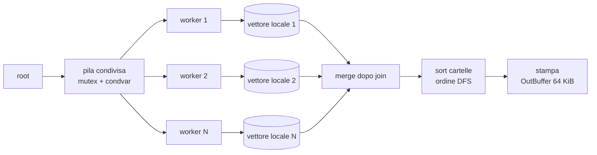

# Architettura di LSer

Questo documento spiega **perché** LSer è fatto così. Dove un'affermazione è misurata viene indicato il numero e la
fonte (vedi [BENCHMARKS.md](BENCHMARKS.md)); dove è un'ipotesi, è scritto esplicitamente.

## 1. Pipeline



1. **Scansione**: ogni task è "leggi *questa* cartella". Il worker fa `opendir`, `readdir`, e (solo se servono
   dettagli) una `fstatat` per entry. Le sottocartelle trovate diventano nuovi task.
2. **Ordinamento locale**: il worker ordina le entry della cartella appena letta, mentre i dati sono ancora in cache.
3. **Raccolta**: ogni worker scrive in un proprio `std::vector<DirectoryResult>`: nessun lock sui risultati.
4. **Merge** dopo il `join`, poi ordinamento dell'elenco cartelle in ordine di visita in profondità.
5. **Stampa** (single-thread) in un buffer scritto con `fwrite`.

Il motore (`run_engine_only()`) copre i punti 1–4. La stampa è separata ed è ciò che il benchmark *non* misura.

## 2. Modello dei dati

```cpp
struct FileEntry {            // sizeof == 80
  std::string name;           // solo il nome, non il path
  uintmax_t size; int64_t mtime_sec; uint32_t mtime_nsec, mode, uid, gid, nlink;
  int32_t link_idx;           // indice nel vettore dei target dei symlink
  FileType type; bool has_details;
};
struct DirectoryResult {      // sizeof == 80
  std::string path;           // path della cartella: UNA volta sola
  std::vector<FileEntry> entries;
  std::vector<std::string> links;   // target dei symlink (solo -l / -T)
};
```

Scelte:

- **Solo il nome nell'entry.** Un `fs::path` completo per ogni file significa quasi sempre un'allocazione heap
  (i path superano facilmente i 15 caratteri della SSO). Un nome di file medio sta nella SSO: nessuna allocazione.
  Il path completo si ricostruisce solo se serve (`join_path`).
- **Target dei symlink in un vettore a parte.** Sono rari: tenerli dentro `FileEntry` avrebbe aggiunto 32 byte
  a *ogni* entry. L'entry paga solo un `int32_t`.
- **Tipo dal `d_type`.** Il kernel lo restituisce dentro `readdir` senza syscall aggiuntive. Si fa `fstatat` solo se
  servono `size`/`mtime`/`mode` (`-l`, `-S`, `-t`) o se il filesystem restituisce `DT_UNKNOWN`.

## 3. Dalle mappe ai vettori piatti

L'approccio naive è `std::map<path, std::vector<Entry>>` (o `unordered_map`) per raggruppare i file per cartella.
Ogni nodo è un'allocazione separata, chiavi e valori sono sparsi nell'heap, e ogni inserimento concorrente richiede
un lock globale sulla mappa.

LSer tiene invece:

- **un vettore per thread** (`results[id]`), a cui scrive solo quel thread: nessuna contesa, nessun lock;
- **un unico `std::vector<DirectoryResult>`** dopo il merge: ordinabile e iterabile in modo sequenziale.

La gerarchia del tree view non è memorizzata: quando serve, `print_tree()` costruisce **una volta** un
`unordered_map<string_view, const DirectoryResult*>` (chiave = path cartella) e scende lungo i figli con lookup O(1)
medio. Costo: O(numero di cartelle) per l'indice, O(n) complessivo per la stampa. L'indice è temporaneo e non fa parte
dei dati del motore. Quindi: **lo storage è piatto, la mappa esiste solo come indice di lettura nel tree view**.

## 4. CPU time vs memory churn

Misure su `/usr/include`, 30573 entry (`--track-memory`):

| Metrica | Valore | Per entry |
|---|---|---|
| Allocazioni per run | ~17 000 | ~0,56 |
| Churn (byte allocati in totale) | ~8,3 MiB | ~285 B |
| Picco di heap C++ | ~5,84 MiB | ~200 B |

Le decisioni che spostano questi numeri:

- **`reserve(16)` per cartella, niente `shrink_to_fit()`.** `shrink_to_fit` alloca un nuovo buffer e copia: più
  churn, e in cambio libera memoria di dati che vivono comunque solo per la durata della run. `reserve(16)` evita le
  riallocazioni 1→2→4→8 nelle cartelle piccole; nelle cartelle grandi il vettore cresce in modo ammortizzato.
- **Ordinamento nel worker.** Le entry sono appena state scritte e sono calde in cache; ordinarle dopo, su un thread
  solo, costerebbe sia in tempo sia in cache miss.
- **Un'allocazione per cartella** per la stringa del path (serve ai figli come prefisso).

Il "peak" riportato è il picco dell'heap C++ (somma dei `malloc_usable_size` vivi), **non** la RSS del processo, che
include anche eseguibile, librerie, stack dei thread e arene di glibc (una per thread).

## 5. Concorrenza

Il meccanismo è una **pila condivisa** (`std::vector<Task>` usato in LIFO) protetta da un mutex, con una
`condition_variable` e un contatore `pending` = cartelle in coda *più* cartelle in lavorazione.

```
worker:  lock → attendi (pila non vuota || pending == 0) → se pila vuota: esci → pop → unlock
         scan(cartella) → lock → push sottocartelle; pending += figli; pending -= 1 → unlock
         se pending == 0: notify_all
```

Perché termina correttamente: `pending` viene incrementato per i figli **prima** di essere decrementato per il padre,
nello stesso blocco sotto lock; quindi non può valere 0 finché esiste lavoro. Quando vale 0 e la pila è vuota, tutti i
worker in attesa si svegliano ed escono. Il test di correttezza ripete la scansione 100 volte con 1, 2, 4 e 8 thread
(anche sotto ThreadSanitizer) per cercare race e deadlock.

> **Nota di onestà.** È una coda di *work-sharing* (una struttura condivisa), **non** una work-stealing queue (code
> per-thread da cui i thread rubano). Il lock è tenuto solo per `push`/`pop`: il lavoro costoso (syscall) è fuori dal
> lock.

### Carico I/O del kernel

`readdir` e `fstatat` sono syscall bloccanti. Con la page cache calda sono veloci ma non gratis: attraversano la VFS
(lookup dei dentry, lock degli inode). Più thread permettono di sovrapporre queste attese e di usare più core.
Nei benchmark lo scaling è reale ma sub-lineare:

| Thread | 1 | 2 | 4 | 8 |
|---|---|---|---|---|
| `Recursive_Simple` (speedup) | 1,00× | 1,68× | 2,66× | 4,04× |
| `Recursive_LongFormat` (speedup) | 1,00× | 1,80× | 2,85× | 3,81× |

Cause **probabili** (non profilate): lavoro per task piccolo (poche decine di entry per cartella), lock interni della
VFS condivisi tra thread, la parte seriale finale (merge + ordinamento cartelle), e overhead di sincronizzazione.
Il profiling con `perf` è il passo successivo per distinguere i contributi.

## 6. Sicurezza e correttezza

- **Niente symlink seguiti.** Si usa `AT_SYMLINK_NOFOLLOW`/`d_type`: un link a una cartella è un'entry di tipo
  `Symlink`, non un task. Un link a un antenato non può quindi creare loop. (La radice indicata dall'utente viene
  invece risolta, come fa `ls`.)
- **Errori non fatali.** `opendir`/`fstatat`/`readdir` falliti finiscono in un `ErrorSink` (con mutex) e vengono
  stampati ordinati su stderr; il resto della scansione prosegue. Un'eccezione dentro un worker viene catturata e
  riportata come errore invece di chiamare `std::terminate`.
- **Verifica esterna.** Il benchmark confronta il conteggio con `std::filesystem::recursive_directory_iterator`.

## 7. Ordinamento

- Il comparatore ha una direzione naturale (nome crescente, dimensione e data decrescenti) e `-R` la inverte per
  intero, spareggi inclusi: resta un ordine totale e deterministico.
- Le **cartelle** sono ordinate in ordine di visita in profondità (`path_less`): un padre viene sempre prima dei
  discendenti, e `/` conta come il carattere minimo (`a/b` prima di `a-b`). Con `-R` si invertono solo i fratelli.
- `std::execution::par` (TBB) viene usato **solo** per l'ordinamento dell'elenco cartelle, e solo sopra le 20 000
  cartelle, dove ripaga l'overhead. L'ordinamento delle entry avviene già in parallelo perché distribuito tra i worker.

## 8. Output

`OutBuffer` accumula con `std::format_to` e scrive con `fwrite` ogni 64 KiB, invece di una chiamata di stampa per riga.
Nel formato lungo le larghezze delle colonne sono calcolate per cartella, come `ls`; utenti e gruppi sono risolti una
sola volta e messi in cache.

## 9. Cosa non c'è (ancora)

- Vere code per-thread con work stealing; batch di task per ridurre il lock.
- `getdents64` diretto con buffer grandi (oggi `readdir` di glibc) e `statx`/`io_uring` per batch di `stat`.
- Collation di locale; ACL/xattr; deduplicazione degli hard link.
- Profiling `perf` documentato (cache miss, contesa sul mutex).
